# 简洁记账

iOS 26「液态玻璃」风格的 Android 记账 App。

- **数据全在手机上**：Room / SQLite 本地存储，不联网、`AndroidManifest` 里一个权限都没有，没有账号体系也没有后端。
- **没有第三方 UI 库**：饼图、余额走势图、日期滚轮、左滑删除、收据纸面全部 Canvas 自绘，依赖只有 AndroidX / Compose / Room / Coroutines。
- 四个页签：**记账 / 资产 / 统计 / 设置**，加二级页：账户详情、账单详情、选银行、开户表单。

## 界面

| 记账首页 | 资产总览 | 统计 | 设置 |
|:---:|:---:|:---:|:---:|
| <a href="docs/screenshots/01-ledger.png">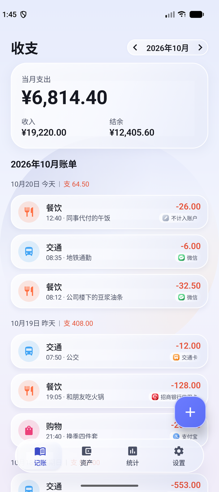</a> | <a href="docs/screenshots/02-assets.png">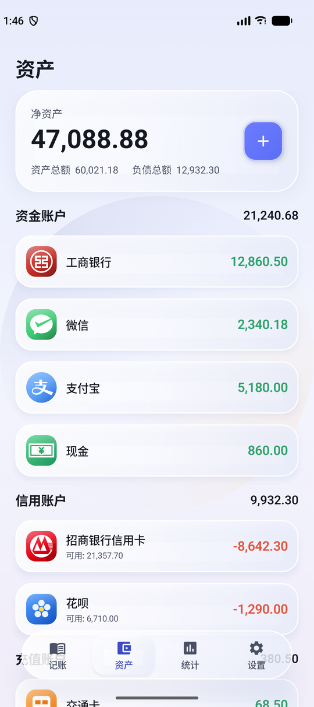</a> | <a href="docs/screenshots/03-stats.png">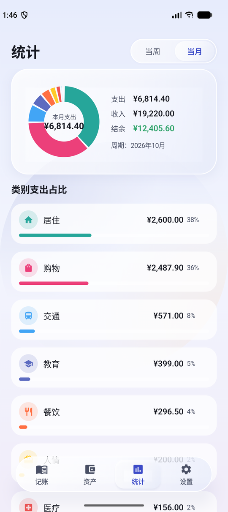</a> | <a href="docs/screenshots/04-settings.png">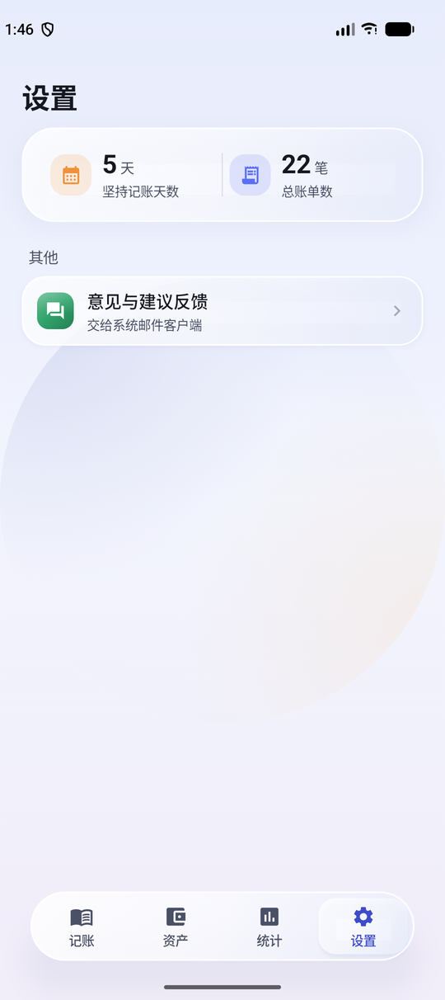</a> |
| 记一笔 | 选择账户 | 账户类型 | 开户表单 |
| <a href="docs/screenshots/05-add-record.png">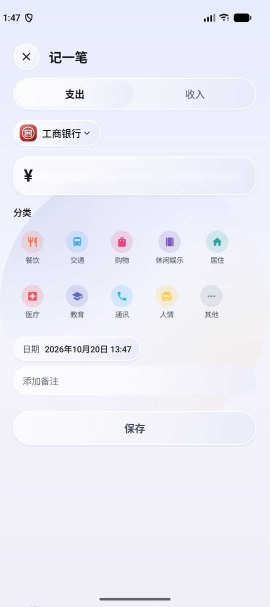</a> | <a href="docs/screenshots/06-account-picker.png">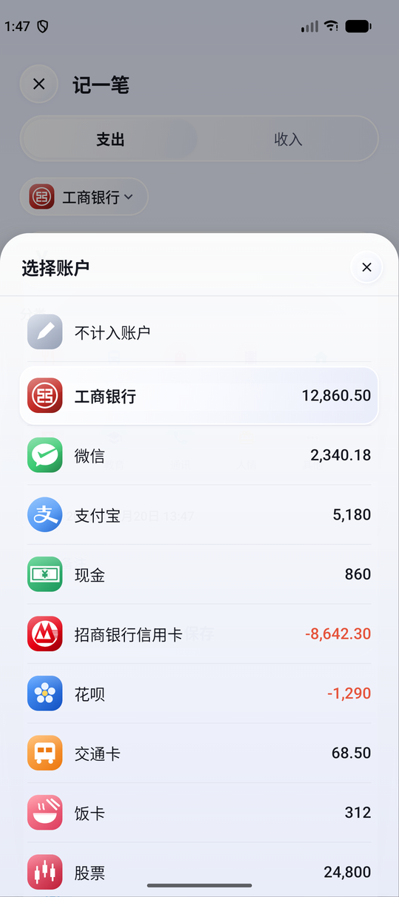</a> | <a href="docs/screenshots/07-account-type.png">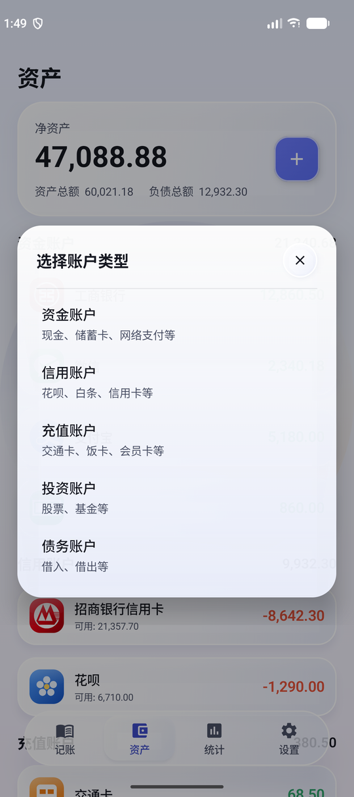</a> | <a href="docs/screenshots/08-add-account.png">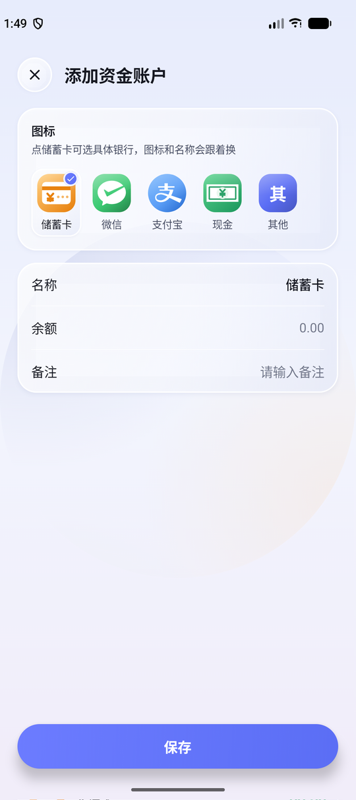</a> |
| 选择银行 | 账户详情 | 账单详情（收据） | 日期滚轮 |
| <a href="docs/screenshots/09-banks.png">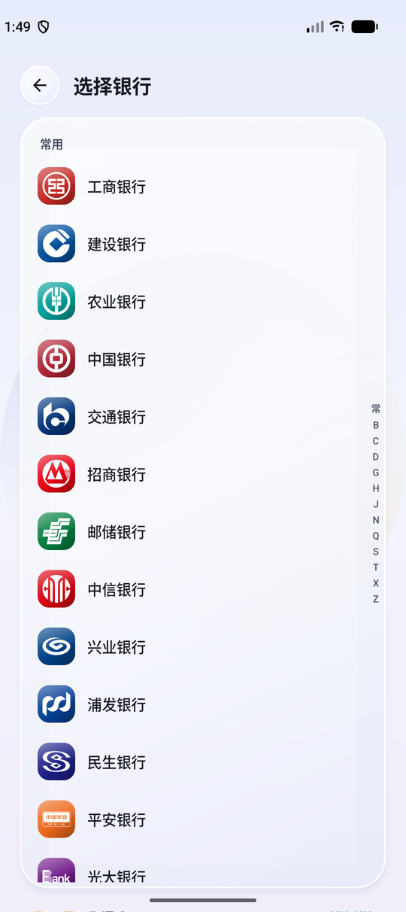</a> | <a href="docs/screenshots/10-account-detail.png">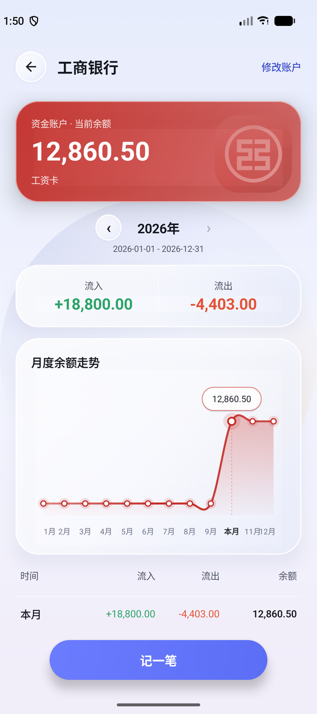</a> | <a href="docs/screenshots/11-receipt.png">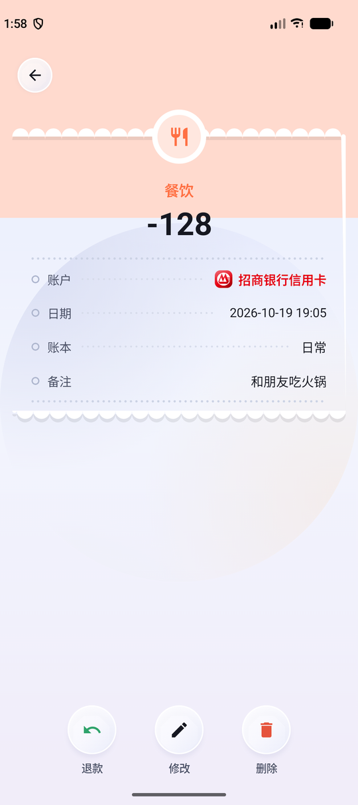</a> | <a href="docs/screenshots/12-date-wheel.png">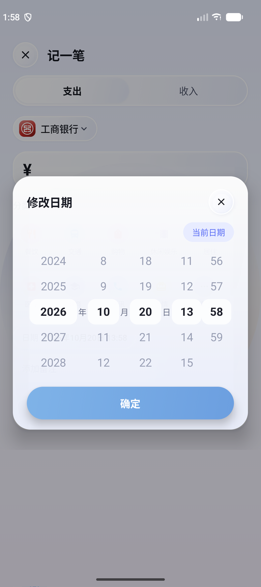</a> |

> 截图里的账户和流水是演示数据，装到手机上时是空的。

## 功能

**记账** —— 右下角 `+` 弹出「记一笔」：支出/收入 → 当前账户（一个胶囊，默认上次用的那个）→ 金额 → 分类 → 日期 → 备注。账户胶囊可以换成别的账户，也可以选**不计入账户**：这笔照常记账、照常进统计，只是不动任何余额。首页列表按天分组，每天一行小计；点一笔进账单详情，长按直接弹删除确认。

**资产** —— 五类账户：资金 / 信用 / 充值 / 投资 / 债务。开户先选类型再进表单，图标格是固定的（资金 = 储蓄卡/微信/支付宝/现金/其他，信用 = 信用卡/花呗/白条/其他…），点「储蓄卡」或「信用卡」会进**选择银行**：43 家主流银行，15 家常用在前、其余按拼音分组、右侧 A–Z 索引条跳转，32 家已内置官方 logo。选中之后图标、底色、账户名一起换。账户行**左滑**露出红色删除；账户名全局唯一，重名时点保存会提示「账户名称已存在」，改到唯一才存得进去。

**账户详情** —— 点任一账户进入：余额主卡、按年份切换的流入/流出、月度余额走势图、月度账单表格、账户备注，可以直接「记一笔」（预选这个账户），右上角改资料。

**账单详情** —— 收据样式：分类色通栏 + 扇贝撕边白纸 + 点线明细。底部三个圆钮：**退款 / 修改 / 删除**。退款在同一事务里把金额原路回补账户余额并打标记，之后这笔不再计入任何统计；「修改」复用记一笔面板，保存时先撤销旧流水的余额影响再按新值重放。

**统计** —— 当周 / 当月切换，环形图按分类占比，下面逐条列出金额和百分比。

**设置** —— 坚持记账天数、总账单数、意见反馈（调起系统邮件，正文自带版本和机型）。

## 数字口径

| 说法 | 怎么算 |
|---|---|
| 净资产 | 资产总额 − 负债总额，且恒等于所有账户余额之和（两条 SQL 谓词互斥互补） |
| 负债类 | 信用卡 / 花呗 / 白条一律负数；债务账户看图标定方向：借出 = 正（别人欠我，算资产），借入 = 负（我欠人，算负债） |
| 退款 | 打了退款标记的流水不进任何聚合（月概览、饼图、账户流入流出、每日小计），只有列表和详情页还看得到 |
| 记账天数 | 取安装包首次安装时间，`今天 − 安装日 + 1`；覆盖安装不重置，卸载重装才归零 |

## 跑起来

```bash
./gradlew :app:assembleDebug      # 调试包
./gradlew :app:assembleRelease    # 正式包（已开 R8 混淆，约 1.7MB；调试包 17MB）
```

Android Studio（Iguana 以上）直接 Open 本目录，Sync 完 Run 到真机或模拟器即可。minSdk 26，compileSdk / targetSdk 35。

- 正式包的混淆产物在 `app/build/outputs/mapping/release/mapping.txt`，**每次发版都要自己存一份**，`build/` 被 gitignore，`clean` 会删掉它；没有它就解不开以后用户报的崩溃栈。
- 首次打开若提示缺 Gradle Wrapper：`gradle wrapper --gradle-version 8.9`。

## 工程结构

```
app/src/main/java/com/glass/ledger/
├── data/            实体、Room DAO、LedgerRepository（唯一读写出口）、图标与银行目录
├── ui/base/         ★ 设计基座：GlassTokens / GlassPage / GlassDialog / GlassBottomSheet
│                    新界面一律从这里起步，圆角、间距、玻璃浓度、状态栏都只在这一层定义
├── ui/components/   自绘控件：LiquidGlass、GlassBackdrop、PieChart、ReceiptCard、
│                    NumberWheel、SwipeDeleteRow
├── ui/screens/      记账 / 资产 / 统计 / 设置 + 账户详情 / 账单详情 / 各弹层
└── ui/theme/        液态玻璃配色
app/src/main/res/drawable/   21 个通用立体渐变图标 + 32 个银行 logo（ic_bank_*.xml）
```

## 更多

改代码前先读 [docs/dev-notes.md](docs/dev-notes.md)：功能对照表（需求 → 落在哪个文件）、Base 设计规范、Room 迁移注意事项、逐条设计说明和踩坑记录（为什么全屏弹窗必须用 `GlassPageDialog`、左滑删除钮为什么不能常驻、滚轮为什么不能拿 `isScrollInProgress` 当闸门……）。
